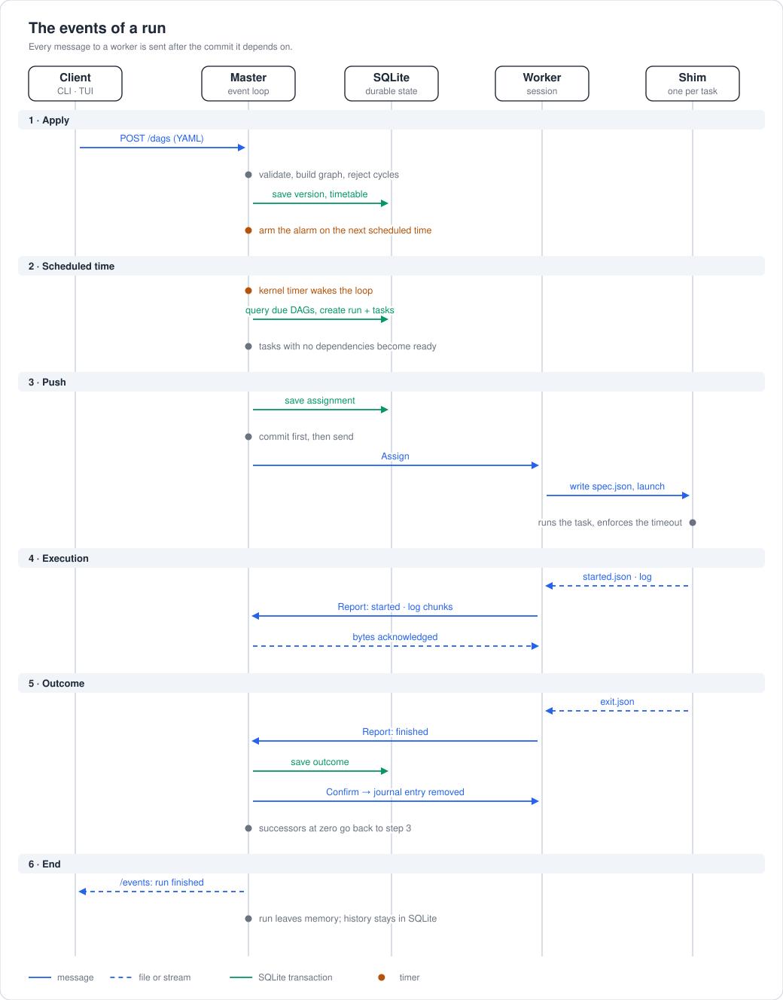

# lwwo: design

lwwo, the Lightweight Workflow Orchestrator, runs DAGs of tasks on a schedule: one Rust binary that is master, worker, command line and terminal interface, with SQLite as its only store.

This document describes how lwwo works: every component, message, file and rule, precisely enough to reimplement it. The [README](../README.md) is the introduction; [configuration.md](configuration.md) and [database.md](database.md) are the references. Why each choice was made, and what was rejected, is in [decisions.md](decisions.md); what is implemented, measured and still missing is in [status.md](status.md).

## The design in brief

Each line is a property the rest of the document explains.

| | Fact | Why |
| --- | --- | --- |
| 1 | **One binary, four roles:** master, worker, CLI, TUI | nothing to install but one file |
| 2 | **Decisions are separate from I/O.** A core library with no dependencies takes an event and the current time and returns commands | days of runs are simulated in milliseconds, always the same way |
| 3 | **The master is one event loop** that owns all the state | no locks, and every event is handled in the same order |
| 4 | **Nothing is polled.** One kernel timer is armed on the next thing due; between events the master uses no CPU | no delay of a polling interval, no queries without work |
| 5 | **SQLite is the only store, the master its only writer** | one file to back up; no service to keep alive |
| 6 | **Commit first, then send.** A message to a worker leaves only after the transaction it depends on | a master crash loses no work and reruns nothing |
| 7 | **Work is pushed** to workers over one gRPC stream that each worker opens; logs travel on a second stream | no polling on the workers either, and a big log never delays a heartbeat |
| 8 | **The run engine is Kahn's algorithm, run incrementally:** a counter of missing dependencies per task | tens of nanoseconds per task; the graph is never the bottleneck |
| 9 | **The worker does not hold its tasks.** It writes a journal and hands each task to a small guardian process, the shim | a worker can restart, or be upgraded, without touching what runs |
| 10 | **Delivery is at least once,** and an outcome is kept until the master confirms it | tasks must be idempotent; in exchange nothing is lost |
| 11 | **Workers join with a token and then use certificates** from the master's own CA, renewed by themselves | mutual TLS with nothing to hand out, as in Docker Swarm |
| 12 | **An error stops only what it is about:** one run, one DAG | a strange piece of data cannot bring the master down in a loop |
| 13 | **Clients use only the HTTP API.** The TUI is a client like the CLI | one door to guard, and it works over SSH |
| 14 | **Out of scope:** data passing between tasks, secret storage, a web UI, a second master | each adds a service or a store to operate |

## Overview

```text
  CLI and TUI                       worker w1               worker w2
  apply · run · tui                ┌───────────────┐       ┌───────────────┐
      │                            │ shim ─▶ task  │       │ shim ─▶ task  │
      │ HTTP/JSON                  │ shim ─▶ task  │       │               │
      ▼                            └──────┬────────┘       └──────┬────────┘
┌───────────────┐   Assign, Cancel ▶      │  gRPC, stream opened by the worker
│    MASTER     │◀────────────────────────┴───────────────────────┘
│  event loop   │   ◀ Hello, Heartbeat, Report · logs on a separate stream
└──────┬────────┘
       │ only writer
       ▼
  SQLite (WAL)        task logs on disk, one file per attempt
```

The master is the only process that talks to SQLite and to the workers. The data that tasks produce never passes through it.

## Components

The system has seven parts. Master, worker, shim and client are the same Rust binary, `lwwo`, started in different modes.

| Component | Role | Technology |
| --- | --- | --- |
| DAG | describes a workflow: tasks, dependencies, schedule, command | a YAML file, loaded with `lwwo apply` |
| Database | stores DAGs and their versions, runs, task state and the next scheduled time of every DAG | SQLite in WAL mode; only the master writes |
| Master | accepts applies and commands, starts scheduled runs, decides which tasks start and on which worker | `lwwo master`: tokio event loop around `lwwo-core`, HTTP/JSON API, gRPC endpoint |
| Worker | connects to the master, receives tasks, starts a shim for each one, ships logs and reports outcomes | `lwwo worker` |
| Shim | the guardian of one task: starts it, writes its output to the spool, enforces its timeout and writes its outcome; it outlives a restart of the worker | `lwwo shim <directory>`, started by the worker, one per attempt |
| Task | the actual work | a command, run as a process on the worker's host; containers and code checkouts, when needed, are part of the command |
| Client | commands and a terminal interface: the CLI (`lwwo apply`, `run`, `logs`…) and the TUI, which shows DAGs, runs, tasks, workers and logs and accepts actions from the keyboard, in the style of k9s | uses only the master's HTTP API, with streaming for updates; the TUI is built with ratatui |

`lwwo standalone` runs a master and a worker in one process, with data in `./lwwo-data` and the API on `127.0.0.1:7070` without a token: the same components, for trying lwwo on one machine.

## Code structure

The code is split into two crates: a core that decides and a program that executes.

- **The core** (`lwwo-core`) is a library with no I/O. It receives an event and the current time and returns commands. It never touches the database, the network, the clock or processes.
- **The program** (`lwwo`) is the binary: master, worker, shim, CLI and TUI. It executes the core's commands and feeds events back to it.

```text
program → core:  "it is 03:00"
core → program:  "save the run of etl, send task extract to W1, wake me at 04:00"
program:         writes to SQLite, sends the gRPC message, arms the timer
program → core:  "extract succeeded"
core → program:  "save the outcome, send clean to W1 and count to W2"
```

Each crate has its own `Cargo.toml`, so the core cannot come to depend on tokio or SQLite by accident. A program that needs only a workflow engine can embed the core alone, and the tests simulate days of runs in a few milliseconds.

The directory layout and the checks that guard the core are described under "Repository".

## The life of a run

The diagram shows the events of a run, from apply to the end, and which component produces each one.



A run goes through seven steps. Steps four to six repeat until every task has finished.

1. **Apply.** `lwwo apply etl.yaml` reaches the master's API. The master validates the YAML, builds its graph to reject cycles, and saves the version and the timetable entry in the database. If the new scheduled time comes before the instant the alarm is armed on, the alarm is re-armed.
2. **Schedule.** At the scheduled time the kernel wakes the master, which asks the database which DAGs are due, with their YAML. For each one it builds the graph, unless it is already in memory, and in a single transaction creates the run with its tasks and advances the timetable. It then asks the database for the next scheduled time and re-arms the alarm.
3. **Ready tasks.** Tasks without dependencies enter the ready queue.
4. **Push.** For each free slot the master picks a worker with the required labels and saves the assignment. Only after the commit does it send `Assign`.
5. **Execution.** The worker creates the working directory, launches the task and supervises it, while it keeps sending heartbeats.
6. **Outcome.** The worker sends `Report`. The master saves it, answers with `Confirm` and unblocks the successors: those with no dependency left go back to step 4.
7. **End.** When every task has finished, the run leaves memory and remains only in the database. The DAG's graph leaves memory with its last open run.

```text
master                SQLite            w1                w2
  │ run + tasks ───────▶│
  │ extract → w1 ──────▶│  commit
  │ Assign extract ─────────────────────▶│
  │◀──────────────────── Report: success │
  │ outcome, clean → w1, count → w2 ───▶│  commit
  │ Confirm extract ────────────────────▶│
  │ Assign clean ───────────────────────▶│
  │ Assign count ────────────────────────────────────────▶│
  │◀───────────────────────────────────── Report: success │   load still waits
  │◀──────────────────── Report: success │                    for clean
  │ outcome, load → w1 ─▶│  commit
  │ Assign load ────────────────────────▶│
```

`clean` and `count` run at the same time on w1 and w2. `count` finishes first, but `load` starts only when `clean` reports too and its counter reaches zero. Every `Assign` and every `Confirm` is sent after the commit it depends on.

## Inside the master

The master is one process made of these parts:

| Part | What it does | Described in |
| --- | --- | --- |
| event loop | owns all the state; handles one event at a time with `lwwo-core` and executes the commands it returns | this section, "The run engine" |
| store | the SQLite database: every change is written there before it is announced | "Database" |
| HTTP API | serves the CLI and the TUI | "HTTP API" |
| gRPC endpoint | the stream of each worker and the log stream | "Master–worker protocol" |
| alarm | one timerfd armed on the next deadline (on Linux; on macOS a check at least once a minute) | "How the master wakes up" |
| log store | one file per attempt on disk, outside SQLite | "Logs" |
| alerts | optional webhook for stuck tasks and failed runs | "Alerts" |

The master keeps its state in memory and wakes only when an event occurs. Every change is written to the database. The database is read to take decisions only at startup and when a scheduled time arrives; all other reads serve the API, for history.

- **One event loop.** A single tokio task owns all the state and waits for four things: the alarm, worker messages, API requests and changes of the system clock. There are no locks, and the database is never polled.
- **One order for every event:** update memory, write to SQLite, push the newly ready tasks to the workers.
- **Deadlines.** The scheduled times of DAGs live only in the timetable, in the database; the master remembers just the nearest one. Retries and heartbeat expiries live in memory, ordered by instant. Task timeouts are measured on the worker. A single timerfd is armed on the nearest of all these instants, as an absolute time, and the kernel also reports when the clock is changed.
- **Graphs only for DAGs with open runs.** A graph is built from the YAML when a run starts, unless it is already in memory, and is dropped with the DAG's last open run; on apply it is built only for validation. Tasks are numbered, and successors and predecessors are stored in compact vectors shared by all runs of the same version.
- **The run engine.** Each task has a counter of missing dependencies (Kahn's algorithm). When a task succeeds the counters of its successors are decremented, and those that reach zero enter a single ready queue, served round-robin across runs.
- **Measured costs:** 44 µs to build the graph of a 1,000-task DAG, tens of nanoseconds per task at run time, and less than 10 µs for each of the two timetable queries with 10,000 DAGs. The costs that matter are the write to SQLite and the gRPC message.

### How the master wakes up

The master polls neither the database nor the clock. It computes when the next deadline falls and asks the kernel to wake it at that time; meanwhile its thread is blocked in `epoll_wait` and uses no CPU.

```text
22:19  the master asks the timetable for the next scheduled time: 03:00, for A
       it arms the alarm on 03:00 and sleeps
03:00  the kernel wakes it
       → it asks the timetable which DAGs are due: A
       → it creates the run of A and advances its entry to tomorrow, in one transaction
       → the tasks of A without dependencies become ready and are pushed to the workers
       → it asks for the next scheduled time: 03:15, for B; arms the alarm and sleeps
03:07  a message arrives from a worker: "A.extract succeeded"
       → A.transform becomes ready → push
03:15  alarm → run of B, and so on
```

- **Four things wake the master:** the alarm, a message from a worker, a request to the API and a change of the system clock. The tokio loop waits for all of them with `select!`, which amounts to a single call to `epoll_wait`.
- **The alarm is a timerfd** armed on an absolute time (`TFD_TIMER_ABSTIME`) with `TFD_TIMER_CANCEL_ON_SET`. When the system clock is changed, for example by NTP or by a virtual machine that resumes, the kernel wakes the master at once and it recomputes its deadlines. macOS has no timerfd, and the fallback there is a check at least once a minute. Windows is not supported.
- **Daylight saving is not involved:** the system clock runs in UTC, and the change of hour is handled where scheduled times are computed, in each DAG's time zone.
- **The timetable is not kept in memory.** When a scheduled time arrives the master runs two queries on the `next_fire` index: which DAGs are due now, and when the next scheduled time falls. With 10,000 DAGs each costs 3 to 7 µs. When many DAGs are due together the first query returns them all, and their runs are created in one transaction.
- **One alarm for everything:** the timerfd is armed on the nearest instant among the next scheduled time, the in-memory deadlines (retries and heartbeat expiries) and the daily cleanup of old runs.
- **No polling.** The timetable is read at startup, when a scheduled time arrives, and when a run ends, to start whatever was waiting for it. An `lwwo apply` that brings the next scheduled time forward re-arms the alarm directly, without a read: the master already knows the new instant.
- **One thread decides; tasks run in parallel** on the workers. A decision costs microseconds, while tasks last seconds or hours.
- **The pattern** is the reactor, as in Redis, nginx and systemd timers.

A trace with `strace` of a minimal program built on the same alarm shows the behaviour:

```text
timerfd_create(CLOCK_REALTIME, TFD_CLOEXEC|TFD_NONBLOCK) = 6
timerfd_settime(6, TFD_TIMER_ABSTIME|TFD_TIMER_CANCEL_ON_SET, {it_value={tv_sec=1792964533, …}}) = 0
22:42:10.728  epoll_wait(3, [], 1024, 959) = 0        asleep: the sleep of the fake worker
22:42:11.730  write(1, "from the worker: task finished\n") = 31
22:42:11.730  epoll_wait(3, [timerfd], 1024, -1) = 1  asleep with no deadline…
22:42:13.727  read(6, "\1\0\0\0\0\0\0\0", 8) = 8      …until the kernel wakes it
22:42:13.727  write(1, "fire: create the run\n") = 21
```

The process ran for 3 seconds and used 3 milliseconds of CPU.

### The run engine

The engine is Kahn's algorithm executed incrementally, as the run advances: each task has a counter of missing dependencies and starts when the counter reaches zero.

```text
extract ──┬── clean ──┬── load
          └── count ──┘
```

| Event | extract | clean | count | load | Sent to the workers |
| --- | --- | --- | --- | --- | --- |
| the run starts | **0** | 1 | 1 | 2 | `extract` |
| `extract` succeeds | ✔ | **0** | **0** | 2 | `clean` and `count`, in parallel |
| `count` succeeds | ✔ | running | ✔ | 1 | none: `load` still waits for `clean` |
| `clean` succeeds | ✔ | ✔ | ✔ | **0** | `load` |
| `load` succeeds | ✔ | ✔ | ✔ | ✔ | the run is finished |

1. **On apply,** the `needs` of each task give its predecessors; successors and in-degrees (the number of dependencies of each task) are derived from them, and cycles are rejected in the same pass. The same computation is repeated from the YAML when a run starts, unless the graph is already in memory.
2. **When a run starts,** the in-degrees are copied into the run's counters, and the tasks at zero enter the ready queue.
3. **While there are ready tasks and free slots,** the master sends tasks to the workers; the rest wait in the queue.
4. **When a task succeeds,** the counter of each successor is decremented, and those that reach zero enter the queue.
5. **When a task fails,** its successors can never reach zero and are marked as skipped.

- **A failed task skips only its descendants.** Every task that depends on it, directly or through other tasks, becomes `skipped`; tasks on independent branches continue, and the run ends as `failed` once every task has finished. This is Airflow's `all_success` rule.
- **Retries.** A failed attempt (non-zero exit code, `timeout`, or a refused `Assign`) is retried while the task has failed at most `retries` times; the task waits in `retrying` and then returns to the queue. The wait after the *n*-th failure is `retry_delay` × 2<sup>n−1</sup> with `retry_backoff: exponential` (the default) and `retry_delay` with `fixed`, in both cases capped at `max_retry_delay` when it is set. With the defaults, `retries: 0` and `retry_delay: 30s`, a failed task fails at once.
- **A lost attempt is not a failure.** When its worker is lost, the attempt is recorded as `lost`, its number is used up, and the task returns to the queue without counting against `retries`.
- **Worker selection.** Among the workers that accept tasks, have every label the task requires and have at least `slots` free slots, the master picks the one with the lowest share of slots in use *after* the assignment: `(used + slots) / total`. Ties go round-robin by worker id: the first tied worker after the one chosen last time, wrapping around. A task that fits on no worker stays in the queue without blocking the tasks behind it, and the master stops looking as soon as no worker has a free slot.

The correct order follows without any sorting: a task reaches zero only when all its predecessors have finished. During a run only successors and counters are needed; predecessors are used to compute the in-degrees, for reruns and by the TUI.

The successors of all tasks are stored in one vector, and a second vector gives the position where each task's successors start:

```text
task:         A=0  B=1  C=2  D=3        (A → B, A → C, B → D, C → D)
successors:   [B, C, D, D]
start:        [0, 2, 3, 4, 4]
successors of A = positions 0..2 = [B, C]
```

Measurements of the engine alone, release build, on random DAGs with about 3 dependencies per task:

| Tasks | Edges | Graph construction | Whole run | Per task |
| --- | --- | --- | --- | --- |
| 1,000 | 2,977 | 44 µs | 39 µs | 39 ns |
| 100,000 | 299,959 | 6.1 ms | 5.6 ms | 56 ns |
| 1,000,000 | 2,999,953 | 109 ms | 196 ms | 196 ns |

The graph is not the bottleneck: the costs that matter are the write to SQLite and the gRPC message to the worker.

## Inside the worker

The worker executes tasks, and it must also supervise them, never lose an outcome, and survive both a restart of the master and its own.

- **Registration.** The worker introduces itself with `Hello`: slots, labels and, when it is reconnecting or has just restarted, the tasks already in progress.
- **Liveness.** It sends a heartbeat at the interval the master sets (5 seconds by default). Free memory, CPU and disk are reported for information only; the one signal the master acts on is `accepting`.
- **Delegated execution.** The worker does not run tasks itself. For each attempt it writes down what must be done and launches a *shim*, a small process that stays with the task. From then on the worker only reads files.
- **Whole process tree.** On timeout or cancel the entire process tree of the task is stopped, through a cgroup per task where available.
- **No outcome is lost:** an outcome stays on disk until the master answers with `Confirm`.
- **Autonomy:** when the master is down, tasks continue and the worker keeps trying to reconnect.
- **Slots, not memory:** the master places tasks by free slots, and heavy tasks are directed to suitable workers with labels such as `big`.

### Surviving a worker restart: journal and shim

The master survives its own restarts because everything it knows is in SQLite. The worker achieves the same with two established techniques.

**The journal.** Before it acts, the worker writes down what it is about to do, as a database does with its write-ahead log. The journal is a directory per attempt:

```text
attempts/<run>/<task>/<attempt>/
  spec.json      what to execute         written by the worker, first
  shim.lock      held while the shim     locked by the shim for its whole life
                 is alive
  started.json   the process started     written by the shim
  log.<offset>   the output, in segments written by the shim, shipped and deleted by the worker
  cancel         a request to stop       created by the worker
  exit.json      how the task ended      written by the shim, last
```

- Files are written under a temporary name and then renamed, so a file is either absent or complete.
- **The shim's lock.** The worker tells whether a shim is alive by taking `shim.lock` for an instant: if it succeeds, nobody held it. A shim that finds the lock taken when it starts tries again for up to 1 second, so the worker's test cannot stop it from starting; a lock held longer belongs to another shim, and the second one gives up.
- **How the worker reads them.** One kernel watcher (inotify on Linux, FSEvents on macOS) covers the directories of all attempts in progress. The worker reads an attempt's files when one of them changes, and in any case every 2 seconds, because a shim that dies changes no file. The worker registers the directory before its first read, so a change between two reads is never missed. If the watcher cannot be started, or a directory cannot be watched, the worker reads that attempt's files every 250 ms instead.
- The directory is removed when the master sends `Confirm`, not when the task ends: in between, the outcome exists nowhere else. In steady state the disk holds only the tasks in progress and those awaiting confirmation.

**The shim.** A process can learn the exit code only of its own children. If the worker ran tasks directly, stopping the worker would orphan them and lose their outcomes. Each task therefore has a guardian, `lwwo shim`, the same binary in another mode:

```text
worker ── writes spec.json, launches and detaches ─▶ lwwo shim ── child ──▶ the task
   ▲                                                  │ copies stdout and stderr to log
   │ reads the files                                  │ enforces the timeout
   └──────────────────────────────────────────────────┘ writes exit.json at the end
```

The shim has no network access and no state. The same technique is used by `containerd-shim` and `conmon` for containers and by Nomad's `executor`.

The table shows what happens when each part stops:

| What stops | Consequence |
| --- | --- |
| the worker, which then restarts | tasks continue under their shims; the new worker finds the directories, declares the tasks in its `Hello` and resumes shipping logs and outcomes. No task is restarted |
| the worker, which does not return | after `heartbeat_timeout` the master reassigns the tasks; at the same moment each shim, no longer seeing signs of life from the worker, stops its task. The two copies never overlap |
| the shim | at two reads in a row, about 4 seconds apart at most, the worker finds `shim.lock` unlocked and `exit.json` missing: it stops what is left of the task and reports it as `lost`. The master starts it again without using up a retry |
| the machine | everything stops; at restart the worker finds the directories and reports `lost` |
| the worker's network | after `heartbeat_timeout` the master reassigns the tasks, but the worker is alive and cannot tell a master that is down from one that is unreachable, so its copy continues. When the network returns the master tells it to stop. Until then the task runs twice, which is why tasks must be idempotent |

- **The worker signals liveness to the shims as well:** at every heartbeat it writes the current time to a file. A shim that finds that time older than `heartbeat_timeout` knows that the master has already reassigned the task.
- **One worker per data directory,** as for the master: a lock on `<data_dir>/lock`. Two workers on the same directory would pick up the same attempts.
- **A pid is valid only within one boot of the machine.** The shim stores it together with the boot identifier; after a reboot pids start over, and the worker never signals a pid recorded in a previous boot.
- **Only the worker that owns an attempt writes its end:** an outcome sent by another worker does not alter history.
- **The shim enforces the timeout,** counted from the moment the shim starts. The timeout therefore holds while the worker is down, as it does while the master is down.
- **Shim liveness is a lock, not a pid:** the kernel releases the lock when the shim dies, and a lock cannot be mistaken for another process.
- **Stopping a worker does not stop its tasks.** An upgrade of the worker interrupts nothing. To take a worker out of service, it is drained first with `lwwo drain`.
- **Under systemd, `KillMode=process` is required;** otherwise stopping the service kills its whole control group, shims included.

## Master–worker protocol

A single bidirectional gRPC session, opened by the worker, carries eight messages. Logs travel on a separate stream, and every connection outside the local machine uses mutual TLS. The contract is `proto/lwwo.proto`.

| Message | Direction | Purpose |
| --- | --- | --- |
| `Hello` | worker → master | identifies the worker: slots, labels, tasks in progress, protocol version |
| `Heartbeat` | worker → master | signals that the worker is alive: tasks in progress, free resources (informative), and whether it accepts more tasks |
| `Ack` | worker → master | a task was accepted or refused; a refusal counts as a failed attempt |
| `Report` | worker → master | a task started, or finished: outcome, exit code, times, peak memory |
| `Assign` | master → worker | run a task: command and environment already resolved, timeout |
| `Cancel` | master → worker | stop a task |
| `Drain` | master → worker | finish the tasks in progress and accept no more |
| `Confirm` | master → worker | the outcome is saved and the worker can forget it |

The service has four calls:

| Call | Kind | Purpose |
| --- | --- | --- |
| `Session` | bidirectional stream | the eight messages; the first must be `Hello` |
| `Logs` | bidirectional stream | log chunks from the worker, each acknowledged with the number of bytes the master holds |
| `Join` | request and response | exchanges the join token for a certificate |
| `Renew` | request and response | issues a new certificate before the current one expires |

- **The master resolves templates.** `Assign` carries the final command and environment variables: the worker knows nothing about DAGs or parameters.
- **Tasks in progress include unconfirmed outcomes.** After a master restart, a task that finished but was not yet confirmed is therefore not run again.
- **The master sets the heartbeat interval,** in a header of the response to `Session`, from `[workers] heartbeat_interval`.
- **An attempt is identified by run, task and attempt number,** so a duplicate or late outcome is only confirmed.
- **The protocol is versioned.** `Hello` carries the version of the contract the worker speaks; when it differs from the master's, the session is refused with an explicit message.

The two messages with which a worker registers and signals liveness:

```protobuf
message TaskRef {                 // one attempt of one task of one run
  string run_id = 1;
  string task = 2;
  uint32 attempt = 3;
}

message Hello {
  string worker_id = 1;
  uint32 slots = 2;
  repeated string labels = 3;     // "gpu", "big"
  reserved 4;                     // executors, removed in protocol 2
  uint64 total_memory = 5;
  repeated TaskRef in_flight = 6; // running, or finished and not confirmed
  uint32 protocol = 7;            // the version of this contract the worker speaks
}

message Heartbeat {
  repeated TaskRef in_flight = 1;
  uint64 available_memory = 2;    // informative: for the TUI
  uint64 free_disk = 3;
  bool accepting = 4;             // false = no more tasks for now
}
```

## Security

Workers and clients authenticate the master, and the master authenticates each worker, without any certificate being distributed by hand. The model is that of Docker Swarm.

- **Internal CA.** On its first start the master creates its own certificate authority in `data_dir`. A worker that joins with the token receives a certificate from it, and from then on worker and master communicate over mutual TLS.
- **Fingerprint in the tokens.** Every token contains the fingerprint of the master's CA, which lets workers, CLI and TUI verify that they are talking to the right master. The format is `lwwo1_<CA fingerprint>.<id>.<secret>`.
- **First token.** On its first start the master writes an API token to `<data_dir>/admin.token`, readable only by its own user; it is the token from which all others are created.
- **TLS on the API.** With `auth = "token"` the API is always served over TLS, with the master's certificate or with the one given in `tls_cert`. Plain HTTP is available only with `auth = "none"`, which is accepted only on a loopback address.
- **Standalone.** No TLS and no token: master and worker communicate inside the same process, on a local port chosen at random.
- **Client configuration.** CLI and TUI read the address and the token from `~/.config/lwwo/config.toml` or from `LWWO_API` and `LWWO_TOKEN`.
- **Task secrets.** The orchestrator does not manage them. Tasks obtain them from the service already in place, such as Vault or a cloud secret manager, using the identity of the worker's machine.

### Security model

| Party | What it can do | What stops it from doing more |
| --- | --- | --- |
| Holder of an API token | everything: apply DAGs, start runs, create tokens, remove workers. A DAG is a command, so an API token amounts to command execution on every worker, as the worker's user | there are no roles: an API token is an administrator credential |
| Holder of the join token | register one new worker under an unused name | it cannot call the API or claim the name of a registered worker |
| A worker | receive tasks, report their outcomes, write the logs of its own attempts | its certificate carries its name; outcomes and log chunks for attempts assigned to another worker are discarded |
| A task | whatever the worker's user can do on that machine, including reading the worker's key, its journal and the files of other tasks | nothing: tasks of different DAGs are not isolated from each other |
| Another user of the master's or worker's machine | nothing | data directories are created with mode `0700`, keys and tokens with `0600` |
| A web page open in a browser on the machine of a standalone | nothing | without tokens the API refuses requests that carry an `Origin` header or a `Host` other than `127.0.0.1`, `localhost` or `[::1]` |

- **Standalone has no authentication.** Any process of any user on the machine can use its API, tasks included. It is meant for trying lwwo on a personal machine.
- **Names are restricted.** DAG and task names accept letters, digits, `_` and `-`; worker names also accept `.` and are at most 64 characters long.
- **Token comparison** takes the same time wherever two values differ.
- **Not covered:** no third party has reviewed the design or the code, and dependencies are not audited automatically.

### How a worker joins

The join token is needed only once: with it the worker has a certificate signed by the master's CA, and every later connection is mutual TLS with no token involved. For the operator this amounts to running `lwwo token worker` on the master and giving the token to the worker.

The terms used below:

- **Certificate:** the identity document of a program. It states a name, for example `w3`, contains a public key and carries the signature of the CA.
- **Private key:** the secret paired with the public key in the certificate. It stays on its owner's disk and is used to sign; signatures are verified with the public key.
- **CA:** the authority that signs certificates. Here it is the master itself, which trusts only the certificates it has signed.
- **mTLS:** TLS, as in HTTPS, in which both sides present a certificate, not only the server.
- **Per-connection signature:** each side signs random data of the connection with its private key. The signature differs every time, so a copy of it is useless, and the key itself is never transmitted.

```text
worker                                             master
  │ 1. TLS connection, read-only ─────────────────▶│  the master presents its certificate
  │    does the CA fingerprint match the token?       and the CA (the worker sends nothing)
  │
  │ 2. TLS connection verified against that CA
  │    Join: token, name, certificate request ─────▶│  checks the hash of the token, signs,
  │◀──────────────────────── worker.crt and ca.crt ─│  stores the serial in `workers`
  │
  │ 3. from here on: mTLS, no token
  │    Session: Hello, Heartbeat, Report… ─────────▶│  the worker's name is the certificate's
  │
  │ at two thirds of the certificate's lifetime
  │    Renew: new request ─────────────────────────▶│  issues a new certificate; the old
  │◀──────────────────────────────── worker.crt ───│  one is no longer valid
```

The worker verifies the CA fingerprint before it sends the secret, so an impostor never receives it. From the second connection onward the token is no longer used: the two certificates suffice.

| File | Location | Secret | Purpose |
| --- | --- | --- | --- |
| `ca.key` | master, in `data_dir` | yes, the most sensitive | signs the certificates of master and workers |
| `ca.crt` | master and workers | no | verifies that a certificate was signed by the CA; its fingerprint is in the tokens |
| `master.key`, `master.crt` | master | the key | the master's identity, signed by the CA |
| `worker.key` | worker, in `data_dir` | yes | signs the worker's connections; never leaves the machine |
| `worker.crt` | worker | no | the worker's identity: name, public key, serial number and expiry |

- **Join token.** It contains the fingerprint of `ca.crt` and a secret; the database stores only the hash of the secret. All workers use the same token, as in Swarm, and `lwwo token worker --rotate` replaces it without affecting the workers already joined. So that it can be printed again, the master keeps a copy in `<data_dir>/join.token`, readable only by its own user.
- **One check per connection.** Authentication happens when a stream is opened, not for every message; a stream then stays open for days.
- **Worker name.** A worker's name is the one in its certificate. If `Hello` carries a different name, the master closes the stream.
- **Names cannot be taken over.** Since the join token is shared, it is not sufficient to claim the name of a registered worker: such a `Join` is refused. Reusing a name, for example after reinstalling a machine, requires `lwwo worker remove` first, which needs an API token.
- **API tokens can be revoked.** `lwwo token revoke` invalidates one immediately, and `--expires` sets an expiry. If the last API token is revoked, the master creates a new `admin.token` at its next start, as on first start.
- **The master is identified by certificate, not by address.** The worker verifies that the master's certificate is signed by the CA and carries the name `lwwo-master`, which the CA never issues to a worker. The master can therefore change address without new certificates.
- **One valid certificate per worker.** The master keeps the valid serial number of each worker in memory, so the check does not read the database. A certificate that was revoked, or superseded by a renewal, is refused.
- **Revocation.** `lwwo worker remove w3` sets `revoked_at` in `workers`, closes the stream of w3 and refuses its certificate from then on.
- **Lifetimes.** Worker certificates last 90 days by default (`[workers] cert_lifetime`), as in Docker Swarm; the master's lasts one year and is reissued at every start; the CA's lasts ten years.
- **Renewal.** At two thirds of the lifetime the worker requests a new certificate, with a new key, through `Renew`, and uses it from the next connection. The worker checks its certificate at startup and then sleeps until the renewal is due.
- **CA key.** It exists only in `data_dir`, with mode `0600`, never in the database. Whoever obtains it can sign valid certificates; in that case the CA must be regenerated and the workers must join again with a new token.

## State and failures

Memory holds the working copy of the state. SQLite holds the durable copy, from which memory is rebuilt after a crash.

| Data | In memory | In SQLite |
| --- | --- | --- |
| DAGs | the graph built from the YAML, only for DAGs with open runs | `dags` and `dag_versions`: the YAML of every version |
| Schedules | only the next scheduled time | `timetable`: the next scheduled time of every DAG |
| Other deadlines | retries and heartbeat expiries, ordered by instant | none: at restart they are recomputed from runs and attempts |
| Runs | counters and task states | `dag_runs`, `task_runs` and `task_attempts` |
| Workers | free slots and sessions | `workers`: only the registry of certificates |
| Access | nothing | `tokens`: the hashes of API and join tokens |

The schema, with every table and column, is in [database.md](database.md).

- **The master stops.** It restarts from SQLite: it reloads the unfinished runs with their DAG versions and asks the timetable for the next scheduled time. Workers reconnect and declare what they are running, and no task is run again. A worker that does not reconnect within `heartbeat_timeout` is considered lost.
- **The connection drops.** The worker continues its tasks and keeps trying to reconnect. The master stops sending it work but leaves it its tasks for one `heartbeat_timeout`.
- **A worker stops.** If it restarts in time it finds its tasks, which have continued in the meantime, and nothing else happens. If no heartbeat arrives for `heartbeat_timeout` (30 seconds by default), its tasks return to the queue and the copies left on the machine stop by themselves. The attempt is recorded as `lost` and does not use up a retry, since the task is not at fault.
- **Power is lost.** With WAL and `synchronous=NORMAL` the last transactions may be lost. In the worst case a task runs again: delivery is at least once.

### Master restart: the four cases

| The master stops… | At restart |
| --- | --- |
| after creating a run, before the push | it finds the tasks still ready and pushes them |
| after saving "T1 is assigned to W1" | if W1 declares the task in its `Hello`, the task continues; otherwise it returns to the queue |
| while T1 runs | W1 finishes it and keeps the outcome until the master confirms that it is saved |
| while a scheduled run was due | it finds a scheduled time in the past, and the `catchup` rule decides |

The only loss is the time of the restart: a crash of the master alone causes no task to run again.

### Error containment

The master does not panic on its inputs, and an error does not stop the whole process: it stops the unit it concerns and records why. Kubernetes controllers follow the same rule when they requeue a single object, and Temporal when it blocks a single workflow. Without it, one inconsistent row in the database would crash the master at every restart.

| Inconsistency | Example | Consequence |
| --- | --- | --- |
| the state of a run | an outcome for a task the engine never assigned; a queued task that is not ready | the run is **quarantined**: it ends as `failed`, its tasks in progress are stopped, and the reason is stored with the run (`dag_runs.problem`). Other runs continue |
| a shared counter | the free slots of a worker would become negative | the value is reset to the safe one (no slot in use) and the correction is logged |
| a DAG in the database | the stored YAML of a version can no longer be parsed | its scheduled run is skipped and an error is logged; other DAGs continue |
| a queued run | its DAG version cannot be loaded | the run ends as `failed` with the reason; the queue moves on |
| the database | the disk is full or the file cannot be written | **the master stops**: without durable writes it can guarantee nothing. It can be restarted once the database is writable again |

- **The core never panics on an input.** The remaining assertions are internal invariants of a data structure, which no event can violate.
- **A panic is never caught in order to continue.** After a panic in the middle of a function the state may be half updated, and continuing would be worse than stopping, as with PostgreSQL's PANIC. Errors are handled before the state is touched.
- **In simulations a quarantine is a failure.** Nothing tampers with the state there, so a quarantine can only mean a bug in the engine.
- **The reason is visible:** `lwwo show` prints it at the top of the run, the TUI shows it in the message box, and the `run_failed` alert includes it.

### A single master

There is one master by design, and "the master is the only writer to SQLite" is an enforced constraint, not a convention.

- **Lock on the data directory.** At startup the master takes an exclusive lock on `<data_dir>/lock`. A second master on the same directory refuses to start and says why. Without the lock the two would not corrupt the database, but each would reload the open runs and assign their tasks, so every task would run twice.
- **No stale locks.** The lock is held by the kernel (`flock`) and disappears with the process, even after `kill -9`. It is reliable only on a local disk, which is where the database must reside in any case.

Failures are of two kinds and call for different measures:

| Failure | What is lost | Measure |
| --- | --- | --- |
| the master process dies | the time of the restart: tasks continue on the workers, and none is run again afterwards | a supervisor that restarts it, such as systemd with `Restart=always` |
| the machine or its disk is lost | all the state, unless a copy exists | replication of the SQLite file, for example with Litestream to S3, and a restart from the copy on another machine (not yet verified) |

## Scheduling

The timetable in the database states when each DAG is next due; two rules per DAG decide how delays and overlaps are handled.

- **Timetable.** One row per DAG with its next scheduled time, kept only in the database. When that time arrives the master queries the DAGs that are due, creates their runs and advances their rows in the same transaction. It then queries the next scheduled time and arms the alarm on it; only that instant is kept in memory.
- **Logical time.** Each run carries the time it was scheduled for, not the time it actually starts: the 03:00 run that is caught up at 05:30 still sees 03:00.
- **Catch-up (`catchup`), as in Airflow 3.** With `false`, the default, only the most recent missed occurrence runs after an interruption; with `true` all of them run, in order. Missed occurrences are not created all at once: the timetable row stays behind and advances one occurrence at a time, as the overlap rule allows.
- **Time zones and daylight saving.** The cron of a DAG is read in its `timezone`. A scheduled time that does not exist on a given day, such as 02:30 when clocks go forward from 02:00 to 03:00, runs at the first valid instant after it (03:00); several such times on the same day run once. A time that occurs twice, when clocks go back, runs only the first time.
- **Pause.** Pausing a DAG removes its timetable row, so it is not even queried. Resuming recreates the row with the first occurrence after the moment of resuming: occurrences that fell during the pause are not caught up, whatever `catchup` says. Runs in progress are not affected by a pause.
- **Manual runs.** `lwwo run` accepts `--at`, the logical time of the run, and `--param`, to override a parameter declared in the DAG. Past days are processed with a loop of manual runs, one per date; there is no backfill command. A paused DAG can still be run manually.

| `overlap` | When a run is due while the previous one is still active |
| --- | --- |
| `queue` (default) | the new run waits and starts when the other ends |
| `skip` | the occurrence is skipped; it is recorded only in the master's log (see [status.md](status.md)) |
| `allow` | the runs overlap, up to `max_active`; beyond that the new run waits as with `queue` |
| `replace` | the active run is cancelled and the new one starts |

These are the three policies of Kubernetes CronJobs plus the queue, and they apply to manual runs as well. When several occurrences fall behind while a run is active, with `catchup: false` only the most recent one runs.

Waiting takes two forms:

| What waits | Where the wait is recorded | When it resumes |
| --- | --- | --- |
| a scheduled occurrence | in the timetable: the row stays behind and no run is created | when a run of the DAG ends |
| a manual run | in `dag_runs`, in state `queued` and without tasks | when a run of the DAG ends, ahead of waiting occurrences |

With `skip` a manual run is refused with an error; with `replace` it cancels the active run.

## Rerun

A failed run is rerun in place: each rerun task gets a new attempt in the same run, so the whole history stays together.

| Action | What runs again |
| --- | --- |
| Rerun failed (the default, key `r`) | the failed tasks and those skipped because of them |
| Rerun a task | the chosen task and, by default, all its descendants; optionally only that task |
| Rerun everything | all tasks |

```bash
lwwo rerun <run>                      # the failed tasks
lwwo rerun <run> --task clean         # clean and its descendants
lwwo rerun <run> --task clean --only
lwwo rerun <run> --all
lwwo rerun <run> --current            # with the current version, if the structure is identical
```

- A rerun uses the DAG version the run started with. The current version can be used only when its structure is identical, that is, the same tasks and dependencies; otherwise a new run is required.
- A reopened run is subject to the overlap rule like a new run. With `queue` or `allow`, when there is no room, or other runs of the DAG are already waiting, the run becomes `queued` behind them: the request, the version and the previous state are stored in `dag_runs.rerun`, and the run reopens when its turn comes. With `skip` the rerun is refused; with `replace` the active runs are cancelled. Cancelling a run that waits to be rerun returns it to its previous state. If, when its turn comes, nothing is left to run, the run returns to its previous state and the master logs why.
- "Rerun failed" also includes cancelled tasks, so a cancelled run can be completed.
- Only a finished run can be rerun. The retries of rerun tasks start from zero; attempt numbers continue.
- A task that depends on a task still failed does not run: it remains skipped.
- The engine returns the affected tasks to `blocked` and recomputes only their counters, using the precomputed predecessors.

## Task contract

The orchestrator launches tasks and collects their outcomes; data and secrets remain the responsibility of the task's author.

- **Run identity.** Every task receives the run id, the logical time, the task name, the attempt number and the parameters, as `LWWO_*` environment variables and through templates.
- **No data passing.** lwwo does not pass data between tasks: it neither captures, stores nor transfers task output, and the only result of a task is its exit code. Tasks exchange data through a location derived from the run identity, for example `s3://data/{{ run.date }}/sales.parquet` or `/data/$LWWO_RUN_ID/raw.json`, which must be reachable from every worker that can run them. A path built from the run id is unique per run; one built from the run date is shared by all runs for that day. The attempt number does not belong in an output path, since the next task could not know which attempt to read.
- **Idempotence.** Tasks must be safe to run again: a task that runs twice rewrites the same output.
- **Working directory.** Each attempt runs in a private directory (`LWWO_WORKDIR`, `/work` in a container), created before the task starts and removed when the attempt ends. A `source` checkout is placed there. It holds temporary files, not data shared between tasks.
- **Outcome.** Exit code 0 is success; any other code, or a timeout, is failure.
- **No secret management.** Tasks obtain secrets from the service already in place, such as Vault or a cloud secret manager, using the identity of the worker's machine. Secret values never belong in the YAML.
- **Environment.** A task inherits the worker's environment, except the worker's own `LWWO_` variables, such as its token, which are removed, plus its `env` and the `LWWO_*` variables of the run.
- **What a task runs is up to the task.** lwwo starts one command as a process on the worker's host. A task that needs a container, a checkout of its code or any other preparation does it in that command, for example `docker run …` or a script that runs `git clone`. lwwo neither pulls images nor fetches code.
- **Map and loop** are planned and will require a small task output, to be added as an optional field of the outcome.

## Logs

Task logs are stored on the master, which is the only place clients read them from. Each attempt has its own log, from the first line to the last, and it moves in three steps:

```text
task ─ stdout, stderr ─▶ shim ─ lines ─▶ spool on the worker ─ chunks ─▶ master: one file per attempt
                                         attempts/…/log           ◀─ ack: bytes held ─┘ logs/<dag>/<run>/<task>/<n>.log
```

### Line format

The shim, not the task, writes every line, and every line has the same three fields separated by a tab:

```text
<unix milliseconds>\t<stream>\t<text>\n
1792980004123	O	18432 rows read
1792980004127	E	warning: 112 rows without a customer id
1792980060000	S	timeout: stopping the task
```

| Stream | Source |
| --- | --- |
| `O` | the task's standard output |
| `E` | the task's standard error |
| `S` | lwwo itself: why the task was stopped (`timeout: stopping the task`, `cancelled: stopping the task`, `the worker has been away too long: stopping the task`) and an error that prevented the start |

- **The time is when the shim read the line,** in UTC milliseconds by the worker's clock. It is not a time the task printed, and it is not corrected for clock differences between machines.
- **A line ends at `\n`.** The trailing `\n` or `\r\n` is removed, and the shim adds its own `\n`. Output that ends without a newline becomes a last line when the stream closes.
- **Text is UTF-8.** Bytes that are not valid UTF-8 are replaced with `U+FFFD`. A tab inside the text is kept: only the first two tabs of a line separate fields.
- **stdout and stderr are read separately,** so their relative order is the order in which the shim read them. Lines from the same stream keep their order.
- **The log file holds exactly these lines** on the worker and on the master. The API serves them unchanged; the CLI and the TUI format them.

### On the worker: the spool

- **Segments.** The spool is a set of files in the attempt's journal directory (see "Surviving a worker restart"), each named `log.<offset>` after the position of its first byte in the output: `log.0`, then for example `log.536870912`. The shim appends whole lines to the newest segment and never splits a line between two. The first segment grows to half of `log_spool_max`, every later one to an eighth of it; a line that does not fit starts a new segment.
- **Deleted once received.** After each acknowledgement the worker deletes every segment whose bytes the master holds entirely, except the newest, which the shim may still be writing. The limit therefore counts only the output the master does not yet have.
- **Limit:** `log_spool_max` (1 GB by default). Before writing a line that would bring the segments on disk over the limit, the shim deletes the oldest segment other than `log.0` and the newest, as many times as needed. The beginning and the most recent output stay; the deleted bytes never reach the master, which marks the gap (see "Shipping"). A single line longer than the room left is written anyway. The task itself keeps running.
- The remaining segments are deleted when the master has acknowledged every byte and the attempt has ended.

### Shipping

- **Chunks** travel on the `Logs` stream: run, task, attempt, DAG, the byte offset of the chunk, at most 64 KiB of data, and a `last` flag. The worker has at most one unacknowledged chunk per attempt.
- **Acknowledgement:** the master answers each chunk with the position up to which it holds the output of that attempt. A chunk whose offset is lower is ignored and the worker continues from the position it is told, so no byte is written twice.
- **Gaps.** When the bytes after the acknowledged position are no longer in the spool, the worker sends from the first segment it still has, with that segment's offset. The master accepts a chunk whose offset is higher than its position: the bytes in between count as dropped, the beginning of the log is closed even if it is shorter than half of `max_per_attempt`, and the chunk goes to the end of the log, after the line `[lwwo: log over the limit, middle part dropped]`.
- **While the master is unreachable** the spool keeps growing on the worker, up to its limit. The worker reopens the stream every 2 seconds and, once it is open, resends from the last acknowledged position. After a master restart the master computes its position from its files on disk and from `<attempt>.skipped`, which records the bytes it does not hold: those dropped in a gap and those of discarded `.tail` files.
- **The outcome follows the log.** The worker sends `Report` only after the master has acknowledged the last chunk, which carries `last`. The master therefore saves the outcome when the log is already complete.
- A chunk for an attempt whose log is already closed is acknowledged and discarded.

### On the master

- **Path:** `[logs] dir`, by default `<data_dir>/logs`, then `<dag>/<run id>/<task>/<attempt>.log`, for example `logs/etl/0192f3a4-…/clean/2.log`.
- **While the attempt runs** the file is `<attempt>.part`. When the last chunk arrives, or when the attempt ends without it (the worker was lost), the file is renamed to `<attempt>.log`. An attempt that printed nothing still has an empty `.log`.
- **Limit:** `[logs] max_per_attempt` (100 MB by default). The first half of the limit is kept as the beginning of the log; after that the master keeps only the most recent output, between half and the whole of the limit, in two rotating `.tail` files. When the log is closed the kept end, cut to start at a line boundary, is appended to the beginning after a line `[lwwo: log over the limit, middle part dropped]`. The closed log is therefore at most about `max_per_attempt` long.
- **Recorded with the attempt:** the size of the closed log in `task_attempts.log_bytes`, and whether it was cut in `log_truncated`.
- **Deletion:** the directory of a run is deleted with the run, when it is older than `retention` (30 days by default). There is no other cleanup.
- **Not compressed:** a plain file can be read from any offset without decoding what precedes it.

### Reading

- **API:** `GET /runs/<id>/tasks/<task>/logs`, with `attempt=<n>` (default: the latest attempt) and `follow=true`. The response is `text/plain` in the line format above, and the header `x-lwwo-attempt` gives the attempt served.
- **Pieces:** the master reads at most 4 MB at a time from the file and sends it, then reads on from where it stopped, so a large log is never held in memory.
- **Follow:** with `follow=true` the response stays open while the attempt runs, and new output is sent as it arrives. It ends when the log is closed, or when the attempt has ended without a closed log.
- **Over the limit while following:** once an attempt has written more than half of `max_per_attempt`, the live output stops at that point; the kept end appears when the attempt ends and the log is closed.
- **CLI:** `lwwo logs` prints each line as `HH:MM:SS  text`, in the time zone of the machine running the CLI, with `ERR ` before stderr lines and `lwwo: ` before lwwo's own lines.
- **TUI:** `tab` cycles between all lines, stdout with lwwo's lines, and stderr only; `e` toggles stderr only. stderr is red and lwwo's lines cyan; `[` and `]` switch between attempts.

## Alerts

The master can report situations that need a person. Alerts are off by default and are enabled by setting a webhook in `[alerts]`.

```toml
[alerts]
webhook = "https://hooks.slack.com/services/..."
waiting_after = "15m"    # a ready task that has found no worker for 15 minutes
on_failure = true        # every run that ends as failed
```

There are two alerts, enabled independently:

| Alert | Trigger | Content |
| --- | --- | --- |
| `tasks_waiting` | a task is ready (all its dependencies have finished) and has found no worker for longer than `waiting_after` | the number of waiting tasks and, for each, DAG, task and reason |
| `run_failed` | a run ends as `failed` | DAG, run, logical time and failed tasks |

```text
lwwo: 2 tasks have been waiting for a worker for more than 15m:
• etl_sales / train: no connected worker has the label "gpu"
• report / export: the workers that fit are full
```

- **The core computes the reason,** from the most persistent cause to the most transient: no worker connected, a label that no worker has, a task larger than any worker, workers not accepting, workers full. The reason distinguishes a configuration mistake from a moment of load.
- **Each wait is reported once.** A task that starts and later waits again begins a new wait.
- **No polling.** The master records since when each task has been waiting, after every event and without I/O, and adds the nearest deadline to the same alarm that serves schedules and retries.
- **The payload is a JSON POST** with a readable `text` field, which is what Slack webhooks display, and the structured data beside it for other consumers (verified with a local receiver, not yet with Slack or Teams).
- **Delivery is at most once.** An alert is sent after the commit, in the background, with three attempts; if the webhook does not respond, the failure is logged by the master. Alerts are not stored, so an alert that fell due while the master was down is not sent afterwards.
- **The reason for a wait is always visible,** whether or not alerts are enabled: `lwwo show` prints it below the task table, and in the TUI the task appears as `READY` with the explanation in the message box.

## Database

The database has eight SQLite tables. Only the master writes them, and they are what the state is rebuilt from after a restart; the timetable is also read whenever a scheduled time arrives. Everything else is recomputed in memory.

```text
dags ──┬── dag_versions      every content ever applied
       ├── timetable         the next scheduled time, one row per DAG
       └── dag_runs ──── task_runs ──── task_attempts
            a run         a task          an attempt
                          in the run      of the task

workers   the registry of certificates         tokens   the hashes of the tokens
```

`dag_runs` and `task_attempts` also reference `dag_versions`: every run and every attempt record the DAG version they ran with.

Tasks are linked to their workflow in two ways: through the run and, directly, through the `dag_name` column. `task_runs` is the association table between runs and tasks, which are in a many-to-many relation: a run contains many tasks, and the same task appears in many runs. Task definitions have no table of their own: they are in the YAML of the version, and a task appears in the database only when it runs.

| Table | Written on |
| --- | --- |
| `dags` | apply, pause, deletion |
| `dag_versions` | apply of new content |
| `timetable` | apply, and every scheduled run |
| `dag_runs` | creation, start and end of a run |
| `task_runs` | start of the run, assignment, outcome, skip, rerun |
| `task_attempts` | assignment and end of an attempt |
| `workers` | join and revocation of a worker |
| `tokens` | creation and revocation of a token |

The complete schema, with every table and column explained, is in [database.md](database.md).

### Why DAGs are versioned

A run must finish with the DAG version it started with, even when a new version is applied in the meantime:

```text
03:00  the run of etl starts with version A: extract → clean → load
03:20  version B is applied: clean is removed, load depends directly on extract
03:30  the master restarts
03:40  extract finishes: the run must start clean, as version A specifies
```

Without `dag_versions`, the restarted master would know only version B. Versions serve four purposes:

1. **Runs in progress** finish with their own version, even across a restart.
2. **Reruns** use the version of the run, even for a run from the previous week.
3. **History:** the TUI shows an old run with the graph it had at the time. Airflow introduced DAG versioning in version 3 for this reason.
4. **Rerun with the current version** is allowed only when the structure is identical, which is checked by comparing the `structure` column.

The cost is small: the key is the hash, so applying the same file again adds no row.

### Database design choices

- **Times** are UTC milliseconds in an `INTEGER`. Time zones are needed only to compute scheduled times.
- **Ids** are UUIDv7 stored as text: readable with `sqlite3` and already in chronological order.
- **Constraints.** Tables are `STRICT` and states have `CHECK` constraints, so SQLite rejects wrong types and values.
- **One run per scheduled time.** The unique index on DAG and logical time excludes manual runs, so a manual run with `--at` can repeat a day that already has a run.
- **Direct reference to the DAG.** `task_runs` repeats `dag_name`, so the history of a task is read without a join. The composite foreign key to `dag_runs` guarantees that it matches the DAG of the run.
- **Timetable index.** `timetable_by_time` serves the two queries of every scheduled run. Measured from Python with 10,000 DAGs, each costs 3 to 7 µs with the index and 390 to 520 µs without it.
- **Writes.** The rows of `task_runs` are created together when the run starts, in one transaction; each attempt then takes two transactions, at assignment and at the end. A queued run has only its row in `dag_runs`.
- **Stored states** include `retrying` and `skipped`, so the history of a run is read with a single query.
- **Durability.** SQLite runs in WAL mode with `synchronous=NORMAL`. A crash of the master loses nothing; a power loss can lose the last transactions, and in the worst case a task runs again. With `durability = "full"` nothing is lost, at the cost of slower writes.
- **Cleanup.** Deleting a run cascades to its tasks and attempts. Once a day the runs that finished more than `retention` ago (30 days by default) are deleted, with their logs and the versions no longer referenced.
- **Backup.** `lwwo backup` writes a consistent copy with `VACUUM INTO` while the master runs. The caller chooses a name, never a path: copies are written only to `[storage] backup_dir`, so an API token is not sufficient to make the master write to an arbitrary location. The copy uses its own read-only connection on a separate thread, and the event loop is not blocked. Continuous replication to another machine is possible with Litestream (not yet verified).
- **Schema version.** It is stored in `PRAGMA user_version`, and migrations are embedded in the binary. Version 2 adds `dag_runs.problem`.
- **Not stored:** the compiled graph, which is rebuilt from the YAML when a run starts, and backfills, which are manual runs with `--at`.

## Configuration

Every setting of master, worker, client and DAG file is listed in [configuration.md](configuration.md) with its default. The points relevant to the design are:

- **One name, three spellings.** Master and worker read a TOML file, then environment variables, then flags; the last one wins. `[storage] db` is `LWWO_MASTER_STORAGE_DB` and `--storage-db`.
- **The nearest value wins:** the task field, then the DAG's `defaults`, then the master's `[defaults]`, then the built-in default.
- **Validation on apply.** Whatever would fail only later is rejected immediately: unknown fields, invalid names, cycles, invalid schedules or time zones, and templates that reference undefined values.
- **Tasks are ordered by name,** not by their order in the file, so the hash of a version does not depend on ordering.
- **Templates hold values, not logic.** They use Jinja syntax, as in Airflow, and expose only the identity of the run and its parameters; logic belongs in the tasks. The same values reach each task as `LWWO_*` variables.
- **The worker's own `LWWO_` variables never reach a task:** its configuration, token included, is removed from the task's environment.

### Parameters and manual runs

Parameters are declared in the DAG and reach the command through templates or as environment variables:

```bash
lwwo run sales --param country=FR                       # other parameters keep their defaults
lwwo run sales --at 2026-10-01T03:00 --param country=FR # a run with October 1 as its logical time
```

- **Only declared parameters are accepted:** an unknown name is rejected, so a misspelling does not go unnoticed.
- **The default determines the type:** if `threshold` defaults to 100, `--param threshold=abc` is rejected.
- **Every parameter has a default,** because scheduled runs use the defaults. Required parameters are listed among the postponed items.
- **Final values are stored with the run,** in `dag_runs.params`: a rerun uses the same values, and the TUI shows the parameters of every run.
- **Parameters must not carry secrets,** since they are stored in the database and shown in the TUI.
- **`--at` sets the logical time of the run,** which tasks see as `{{ run.date }}`. Past days are processed with a loop of manual runs:

```bash
for d in 2026-10-{01..25}; do
  lwwo run sales --at "${d}T03:00"
done
```

The API equivalent is `POST /dags/sales/runs` with `{"at": "2026-10-01T03:00:00+02:00", "params": {"country": "FR"}}`.

## HTTP API

CLI, TUI and scripts use only this API. Each request becomes a message to the master's event loop, which replies; the API layer holds no state of its own and does not access SQLite.

| Method and path | Effect |
| --- | --- |
| `POST /dags` | applies a DAG; the body is the YAML |
| `GET /dags`, `GET /dags/<name>` | list and detail |
| `POST /dags/<name>/pause`, `/resume` | pauses or resumes the schedule |
| `DELETE /dags/<name>` | removes the DAG |
| `POST /dags/<name>/runs` | starts a run: `{"at": …, "params": {…}}` |
| `GET /runs?dag=&limit=`, `GET /runs/<id>` | the list, with task counts per run; and one run with its tasks, commands, attempts and, for tasks waiting for a worker, the reason |
| `POST /runs/<id>/cancel`, `/rerun` | cancels or reruns |
| `GET /runs/<id>/tasks/<task>/logs?attempt=&follow=` | the log of an attempt, live with `follow` |
| `GET /workers`, `POST /workers/<name>/drain`, `DELETE /workers/<name>` | connected workers; drain; remove |
| `GET /tokens`, `POST /tokens`, `DELETE /tokens/<id>` | lists tokens; creates one or prints the join token; revokes one |
| `POST /backup` | writes a copy of the database to the backup directory: `{"name": …}` |
| `GET /status` | status of the master |
| `GET /events` | a stream with one line for every change |

- **Streaming updates:** the TUI listens on `/events` and reloads the current screen at every line.
- **Errors** are an HTTP status and `{"error": "…"}`, with a message that states the remedy.
- **Authentication** is `Authorization: Bearer <token>`, except with `auth = "none"`.

## Commands

| Command | Effect |
| --- | --- |
| `lwwo master --config master.toml` | starts the master |
| `lwwo worker --config worker.toml` | starts a worker |
| `lwwo standalone` | runs master and worker in one process, with data in `./lwwo-data` and the API on `127.0.0.1:7070` without a token; accepts the master's settings, plus the worker's in a `[worker]` section |
| `lwwo tui` | opens the TUI; with `--demo`, on sample data without a master |

All other commands talk to a running master through its API:

| Command | Effect |
| --- | --- |
| `lwwo apply <file>` | validates a DAG and stores its version |
| `lwwo run <dag>` | starts a run manually, with `--at` and `--param` |
| `lwwo dags`, `lwwo runs`, `lwwo workers`, `lwwo status` | lists and status |
| `lwwo show <run>` | a run with its tasks; a prefix of the id is sufficient |
| `lwwo logs <run> <task>` | the log of a task, with `--attempt` and `--follow` |
| `lwwo cancel <run>` | cancels a run |
| `lwwo rerun <run>` | reruns the failed tasks, one task (`--task`, `--only`) or all (`--all`) |
| `lwwo pause <dag>`, `lwwo resume <dag>`, `lwwo delete <dag>` | pauses or resumes the schedule; removes the DAG |
| `lwwo drain <worker>` | the worker finishes its tasks and accepts no more |
| `lwwo worker remove <name>` | removes a worker and revokes its certificate |
| `lwwo token worker` | prints the join token; with `--rotate`, replaces it and invalidates the old one |
| `lwwo token api` | creates an API token; with `--expires 90d`, one that expires |
| `lwwo token list`, `lwwo token revoke <id>` | lists tokens, without secrets; revokes one with immediate effect |
| `lwwo backup [name]` | writes a consistent copy of the database to the master's backup directory while the master runs; without a name, the copy is named after the current time |
| `lwwo shim <directory>` | supervises one task; launched by the worker, not by operators |
| `lwwo api <method> <path>` | calls the API and prints the JSON, for scripts |

## The TUI

The terminal interface is `lwwo tui`, part of the same binary. It works over SSH and exposes no web port. `lwwo tui --demo` opens it on sample data, without a master.

The layout and key bindings follow k9s; the double-bordered windows, the `▶` cursor and the HP bars follow early Game Boy games.

```text
 LWWO  RUNS  DAGS  WORKERS                       localhost:7070 workers 2  slots 1/12  ● 1  … 1
╔ RUNS ═══════════════════════════════════════════════════════════════════════════════════════╗
║  DAG              RUN        STATE      HP                 BY       FOR              TIME ║
║▶ train_model      0…0000d4c1 QUEUED     ░░░░░░░░░░ 0/2     manual   02:59:00              ║
║  etl_sales        0…0000a2f1 RUNNING    ████░░░░░░ 3/8     cron     02:56:00         4:12 ║
║  etl_sales        0…0000a19e FAILED     ███████░░░ 5/8     manual   01:56:00         3:00 ║
╚═════════════════════════════════════════════════════════════════════════════════════════════╝
╔═════════════════════════════════════════════════════════════════════════════════════════════╗
║ train_model is queued: 0 of 2 tasks done. Started by manual, for 02:59:00.                  ║
╚═════════════════════════════════════════════════════════════════════════════════════════════╝
 <⏎> open  <t> start  <c> stop  <r> rerun failed  </> filter  <tab> dags  <?> help
```

The screen always has four areas: the status line, the main window, the message box and the key line.

- **Message box.** Events are typed out one at a time: a run that started or finished, the result of an action. When there is nothing to report, the box describes the item under the cursor. Confirmations ("Stop this run?") are asked there, with a YES/NO menu.
- **HP bar.** Every run has a bar: green for succeeded tasks, red for failed ones, empty for those not yet done.
- **A client like the CLI.** The TUI uses the master's HTTP API and never reads SQLite. The master signals every change on `/events` and the screen is reloaded immediately; open logs are streamed live.

There are six screens:

| Screen | Content | Reached with |
| --- | --- | --- |
| RUNS | the most recent runs, with state, HP bar, origin and duration | startup; `tab`; `:runs` |
| DAGS | the DAGs, active or paused, and their next scheduled time | `tab`; `:dags` |
| WORKERS | the connected workers: slots in use, free memory and disk, labels | `tab`; `:workers` |
| Run | the status box of the run, its levels and the task table | `⏎` on a run |
| GRAPH | the whole graph, with every dependency drawn | `tab` inside a run; `g` on a DAG |
| Log | the output of one task, or of all tasks together | `⏎` on a task; `L` for all |

Inside a run, the status box is modelled on a battle screen: name, level reached (`:L2/5`) and HP bar.

```text
╔ RUN ═══════════════════════════╗╔ LEVELS ═══════════════════════════════════════════════════╗
║ etl_sales                :L2/5 ║║  L1          L2         L3          L4         L5         ║
║ HP:█████████░░░░░░░░░░░░░░ 3/8 ║║ ✓ extract   ✓ clean    · model-a   · report   · publish   ║
║ RUNNING  4:12                  ║║             ✓ check    · model-b                          ║
║ cron for 02:56:00              ║║            ▶● enrich                                      ║
╚════════════════════════════════╝╚═══════════════════════════════════════════════════════════╝
```

The graph places tasks in columns by level and draws every dependency. The edges of the task under the cursor are highlighted, and `←` and `→` move the cursor along them, towards the tasks it depends on and towards the tasks that depend on it.

```text
            ┌─▶ ✓ clean ──┬┬─▶ · model-a ─┐
 ✓ extract ─┼─▶ ● enrich ─┴┴─▶ · model-b ─┼─▶ · report ──▶ · publish
            └─▶ ✓ check ──────────────────┘
```

The layout follows the Sugiyama method:

1. A dependency that spans several levels crosses them on a row of its own, so that no edge passes over a task name.
2. A few passes reorder each column by the average position of its neighbours, which removes almost all crossings.
3. Each task takes the median row of the tasks it depends on, so chains stay straight.
4. Between two columns, edges that leave the same task share a vertical segment, as do edges that arrive at the same task.

Key bindings:

| Key | Action |
| --- | --- |
| `↑` `↓` or `j` `k`, `PgUp` `PgDn`, `g` `G` | move the cursor |
| `⏎`, `esc` | open; go back |
| `tab`, `:runs` `:dags` `:workers` | change view |
| `/` | filter the rows of a list, or search in a log |
| `t`, `T` | start a run of the DAG; `T` asks for the parameters first |
| `c` | cancel the run |
| `r` | rerun: in the run list, the failed tasks; inside a run, the selected task and its descendants |
| `f`, `R` | inside a run: rerun the failed tasks, or all tasks |
| `L` | the logs of all tasks of the run, merged in time order and prefixed with the task name |
| `p` | pause or resume the schedule of a DAG |
| `g` | on a DAG: show its graph without starting a run |
| `d` | drain a worker |
| in the log: `tab`, `e`, `[` `]`, `f` | all output, stdout or stderr; errors only; other attempts; follow the end |
| `space`, `?`, `q` | skip the message; help; quit |

Every action asks for confirmation, and those that interrupt work default to NO.

The code has three layers, each independent of the details of the next:

| Layer | Files | Responsibility |
| --- | --- | --- |
| `Backend` | `tui/backend.rs`, `remote.rs`, `demo.rs` | where data comes from and where actions go: the master's API, or sample data |
| `App` | `tui/app.rs` | the state of the interface and how keys change it; no drawing and no terminal access |
| drawing | `tui/ui.rs`, `graph.rs`, `theme.rs`, `dialog.rs` | renders the state to a screen |

This separation lets the tests press keys and inspect the screen without a terminal and without a master.

## Repository

The project is one repository with a Cargo workspace and two crates: `lwwo-core`, the library with no I/O, and `lwwo`, the binary.

### Layout

```text
lwwo/
├── Cargo.toml              # workspace: members, shared lints
├── rust-toolchain.toml     # the pinned Rust version
├── proto/lwwo.proto        # master–worker contract
├── docs/                   # design, configuration and database references
├── examples/               # example DAGs and configuration files
└── crates/
    ├── lwwo-core/          # library with no I/O
    │   ├── clippy.toml         # forbids clock and I/O in the core
    │   ├── src/
    │   │   ├── dag.rs          # DAG model and graph construction
    │   │   ├── run.rs          # run state, counters, retries, rerun
    │   │   ├── ready_queue.rs  # ready queue, round-robin across runs
    │   │   ├── worker_selection.rs # worker selection: slots and labels
    │   │   ├── deadlines.rs    # retries and heartbeat expiries, by instant
    │   │   ├── calendar.rs     # civil dates: leap years, day of week
    │   │   ├── cron.rs         # cron parser and next occurrence in local time
    │   │   ├── time.rs         # instants and time zones
    │   │   ├── timetable.rs    # catch-up and overlap
    │   │   └── engine.rs       # handle(event, now) -> commands
    │   └── tests/sim.rs        # deterministic simulations
    └── lwwo/               # the lwwo binary
        ├── build.rs            # generates the gRPC code from proto/
        ├── src/
        │   ├── main.rs         # commands
        │   ├── config.rs       # TOML, environment variables, flags
        │   ├── dsl/            # YAML parsing and validation, templates
        │   ├── zone.rs         # IANA time zones for the core
        │   ├── store/          # SQLite: schema, migrations, queries
        │   ├── security.rs     # internal CA, certificates, tokens
        │   ├── master/         # state.rs (event loop), api.rs, grpc.rs, logs.rs, timer.rs, alerts.rs
        │   ├── worker/         # session, journal.rs, shim.rs (runs one task), watch.rs, ship.rs (logs), cgroup.rs
        │   ├── client.rs, cli.rs  # HTTP client and commands
        │   └── tui/            # app.rs (state and keys), ui.rs and graph.rs (drawing), remote.rs, demo.rs
        └── tests/e2e.rs        # end-to-end tests with real processes
```

### Two crates

| Crate | Kind | Content |
| --- | --- | --- |
| `lwwo-core` | library | DAG model and graph construction, run state, ready queue, timetable with catch-up and overlap, worker selection, and the function that takes an event and returns commands |
| `lwwo` | binary | all I/O, organised in modules: configuration, YAML, SQLite, master, worker, TUI |

A module of the binary becomes a separate crate only when there is a reason:

| Module | Reason to separate it |
| --- | --- |
| generated gRPC code | compilation becomes slow |
| YAML | users who embed the core also need to read DAGs from YAML |
| TUI | it grows enough to slow down builds |

### Guarding the core

Two rules prevent the core from acquiring I/O.

- **Dependencies.** `lwwo-core` declares no dependencies; `cargo tree -p lwwo-core` lists the crate alone. Adding one is an explicit design decision.
- **Clock and I/O.** A `clippy.toml` in the core's directory forbids the system clock, files, the network, threads and environment variables. It applies only to the core; the binary may use the same calls.

```toml
# crates/lwwo-core/clippy.toml
disallowed-methods = [
  { path = "std::time::SystemTime::now", reason = "the core receives the current time as input" },
  { path = "std::time::Instant::now", reason = "the core receives the current time as input" },
  { path = "std::thread::spawn", reason = "the core does not spawn threads" },
  { path = "std::env::var", reason = "the core does not read the environment" },
]
disallowed-types = [
  { path = "std::fs::File", reason = "the core does no I/O" },
  { path = "std::net::TcpStream", reason = "the core does no I/O" },
]
```

A call to `SystemTime::now()` in the core makes `cargo clippy -- -D warnings` fail with the corresponding reason.

### Dependencies

The core has none. The binary uses:

| Purpose | Crate |
| --- | --- |
| CLI | clap |
| Async runtime | tokio |
| gRPC | tonic, prost |
| HTTP API | axum, with axum-server for TLS |
| HTTP client of CLI and TUI | reqwest |
| SQLite | rusqlite, with SQLite bundled in the binary |
| YAML | serde\_yaml\_ng |
| Templates | minijinja |
| Time zones | jiff |
| Certificates and TLS | rcgen, rustls with ring, x509-parser |
| TUI | ratatui |
| Logging | tracing |
| timerfd, signals, disk | rustix |
| Run ids | uuid (v7) |
| Errors | anyhow |

### Tests and checks

| Command | Scope |
| --- | --- |
| `cargo test --workspace` | unit tests, simulations and end-to-end tests |
| `cargo clippy --workspace --all-targets -- -D warnings` | pedantic lints, and the ban on I/O in the core |
| `cargo fmt --all --check` | formatting |
| `cargo tree -p lwwo-core` | the core has no dependencies |

- **The Rust version is pinned** in `rust-toolchain.toml`: clippy adds lints with every release, and with `-D warnings` each new lint would become an error on the first machine to update.
- **The end-to-end tests** start real `lwwo` processes on free ports. The scheduling test waits for the next minute, so the suite takes up to about a minute.
- **Linux-only parts.** timerfd and cgroups exist only on Linux: the same tests are run there in a container, and the cgroup test in a privileged one.
- **Separate machines.** A further test runs master, two workers and a client in separate containers on a Docker network.
